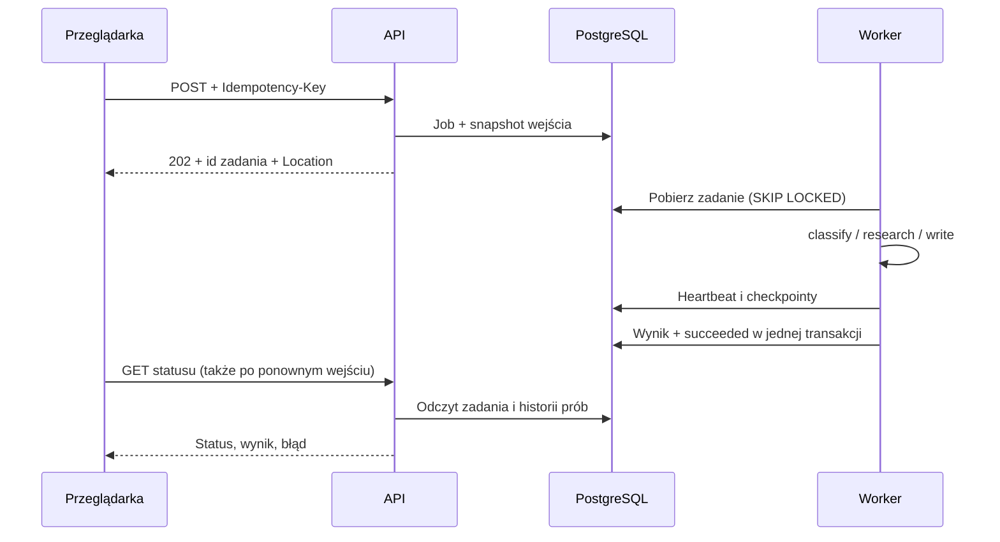

# AI Content Engine — MVP

Automatycznie zbiera nowe wpisy ze źródeł RSS/Atom, deduplikuje je po URL, zapisuje jako
*candidates*, ocenia ich potencjał przez LLM (OpenAI) i pokazuje w panelu administracyjnym,
gdzie można je zatwierdzić (`approved`), odrzucić (`ignored`) lub cofnąć do `pending`.

```text
RSS feeds → Fetch → Normalize → Deduplicate → Save Candidate → LLM Classification → Score + Category → Admin Dashboard
```

## 1. Wymagania

- Docker + Docker Compose v2
- (opcjonalnie, do pracy poza Dockerem) Python 3.13+, Node.js 22+
- klucz OpenAI API — do kroków AI (fetch RSS działa bez niego)

## 2. Instalacja

```bash
git clone <repo> content-engine && cd content-engine
cp .env.example .env        # uzupełnij OPENAI_API_KEY
make up                     # db, migracja, API, worker, scheduler, web
make seed                   # przykładowe źródła RSS
```

## 3. Plik `.env`

| Zmienna | Opis |
|---|---|
| `DATABASE_URL` | URL bazy (SQLAlchemy, sterownik `psycopg`) |
| `TEST_DATABASE_URL` | baza dla testów (`content_test`, tworzona automatycznie przy pierwszym starcie Postgresa) |
| `OPENAI_API_KEY` | klucz OpenAI; bez niego endpointy klasyfikacji zwracają `503` |
| `OPENAI_CLASSIFIER_MODEL` | model klasyfikatora; puste = `gpt-4.1-mini` |
| `NEXT_PUBLIC_API_URL` | adres API widziany z przeglądarki (wkompilowany w build frontendu) |
| `CORS_ORIGINS` | dozwolone originy frontendu, po przecinku |
| `FETCH_INTERVAL_MINUTES` | co ile minut osobny scheduler pobiera RSS i zleca ocenę kolejce (`0` = wyłączone) |
| `FETCH_MAX_AGE_DAYS` | wpisy starsze niż N dni są pomijane przy fetchu (`0` = bez limitu); wpisy bez daty są zachowywane |
| `CLASSIFY_BATCH_LIMIT` | maks. liczba wpisów klasyfikowanych w jednym wywołaniu `classify-pending` (ochrona budżetu LLM) |

`.env` jest w `.gitignore` — nie commituj sekretów.

Lokalnie `CORS_ORIGINS` dopuszcza frontend na `http://localhost:3000` i
`http://localhost:3001` (port zastępczy Next.js, gdy 3000 jest zajęty).
Jeśli uruchamiasz frontend pod innym adresem, dodaj jego dokładny origin
(protokół, host i port) do tej listy. Po zmianie `.env` odtwórz kontener API:
`docker compose up -d --no-deps --force-recreate api`.

## 4. Docker

`docker compose up` uruchamia:

| Usługa | Adres |
|---|---|
| Frontend | http://localhost:3000 |
| API | http://localhost:8000 |
| Swagger | http://localhost:8000/docs |
| PostgreSQL | localhost:5432 (`content` / `content`) |

Komendy `make`:

```text
make up        # docker compose up -d --build
make dev       # Docker + frontend z automatycznym odświeżaniem zmian
make down      # zatrzymanie
make migrate   # alembic upgrade head
make seed      # przykładowe źródła RSS (idempotentne)
make wipe      # kopia bazy + usunięcie danych aplikacji i kolejki
make logs      # logi wszystkich usług
make test      # testy backendu (pytest w kontenerze api)
make fetch     # ręczny fetch wszystkich aktywnych źródeł
make classify  # klasyfikacja niesklasyfikowanych wpisów
```

Kod API jest montowany jako wolumen — po zmianach w Pythonie: `docker compose restart api worker scheduler`.
Frontend jest budowany produkcyjnie — po zmianach: `docker compose up -d --build web`.

Do pracy nad frontendem w Dockerze uruchom `make dev`. Nakładka
`docker-compose.dev.yml` uruchamia `next dev` na http://localhost:3000 i montuje
`apps/web`, więc zapis zmian odświeża interfejs bez przebudowy obrazu. Zależności
`node_modules` i cache `.next` są w osobnych wolumenach kontenera. Po zmianie
`package.json` lub `package-lock.json` ponownie uruchom `make dev`.
Zatrzymaj wcześniej lokalny `npm run dev`, jeśli zajmuje port 3000.
Powrót do produkcyjnego buildu: `make up`. Backend w obu trybach wymaga
restartu po zmianach Pythona, jak wyżej.

## 5. Migracje

Usługa `migrate` wykonuje `alembic upgrade head` przed startem API, workera i schedulera. Migracji nie uruchamia równocześnie każdy proces. Ręcznie:

```bash
make migrate
# nowa migracja po zmianie modeli:
docker compose exec api alembic revision --autogenerate -m "opis zmiany"
```

## 6. Seed

```bash
make seed
```

Dodaje (jeśli nie istnieją) źródła: OpenAI, Anthropic, Google AI, Hugging Face, GitHub.
Lista jest tylko w `apps/api/app/jobs/seed.py` — logika aplikacji nie zna konkretnych źródeł.
Niedziałający feed nie przerywa fetchu pozostałych (błąd jest logowany i liczony w `errors`).

Reset lokalnej bazy i ponowne zasilenie źródeł:

```bash
make wipe
make seed
make fetch
```

`make wipe` wymaga działającego kontenera `db` i lokalnego `python3`. Zatrzymuje
działające API, worker i scheduler, zapisuje kopię SQL w katalogu tymczasowym
(domyślnie `/tmp/content-before-reset-*.sql`) i wypisuje jej ścieżkę.
Następnie usuwa źródła, kandydatów, research, artykuły oraz zadania kolejki
i resetuje ich ID. Zachowuje schemat, migracje i wolumen bazy. Jeśli kopia
się nie powiedzie, danych nie usuwa. Na końcu przywraca wcześniej działające
usługi, również po błędzie. Usługi wcześniej zatrzymane pozostają zatrzymane.

## 7. Uruchomienie i typowy flow

1. `make up && make seed`
2. Otwórz http://localhost:3000 → **Fetch all** → pojawiają się nowe wpisy (`pending`, bez score).
3. **Classify pending** (lub ikona ✨ w wierszu) → zadania w kolejce; po wykonaniu score 0–100, kategoria i uzasadnienie.
4. Approve / Ignore w tabeli lub w szczegółach wpisu.

Ponowny fetch nie tworzy duplikatów (`external_url` jest `UNIQUE`, a serwis odfiltrowuje istniejące URL-e).

## 8. Konfiguracja OpenAI

```env
OPENAI_API_KEY=sk-...
OPENAI_CLASSIFIER_MODEL=gpt-4.1-mini
```

Po zmianie: `docker compose up -d api worker scheduler` (env jest czytany przy starcie). Istniejące zadania zachowują snapshot modeli i ustawień; nowe korzystają z nowej konfiguracji.
Klasyfikator używa Structured Outputs (`responses.parse` + model Pydantic `CandidateClassification`),
więc odpowiedź jest walidowana (score 0–100, kategoria z enumu) bez ręcznego parsowania JSON.
`total_score` liczy backend:

```text
total_score = round(relevance*0.40 + freshness*0.20 + search_potential*0.25 + commercial_potential*0.15)
```

Błąd LLM nie nadpisuje oceny. Status i kolejne próby są zapisane w zadaniu; błędy przejściowe worker ponawia.

## 9. Dodanie źródła RSS

- Panel: **Sources** → formularz *Name* + *RSS URL* → **Add source**.
- API:

```bash
curl -X POST http://localhost:8000/api/sources \
  -H 'Content-Type: application/json' \
  -d '{"name": "TechCrunch AI", "url": "https://techcrunch.com/category/artificial-intelligence/feed/"}'
```

Źródło można wyłączyć (`PATCH /api/sources/{id}` z `{"active": false}`). Usunięcie źródła z historią zadań zwraca `409`, aby zachować tę historię.

## 10. Ręczny fetch

```bash
curl -X POST http://localhost:8000/api/sources/fetch       # wszystkie aktywne
curl -X POST http://localhost:8000/api/sources/3/fetch     # jedno źródło
```

```json
{"sources_processed": 5, "items_found": 42, "new_candidates": 11, "duplicates": 31, "skipped_old": 0, "errors": 0}
```

Osobny scheduler co `FETCH_INTERVAL_MINUTES` pobiera źródła. Jeśli ustawiono
`OPENAI_API_KEY`, zapisuje zadania klasyfikacji (do `CLASSIFY_BATCH_LIMIT` na przebieg). Worker je wykonuje.

## 11. Architektura

```text
content-engine/
├── apps/api            FastAPI + SQLAlchemy 2 (async, psycopg) + Alembic
│   └── app/
│       ├── api/            routery HTTP (cienkie: walidacja, kody błędów)
│       ├── core/           config (pydantic-settings), DB, logging
│       ├── models/         Source, Candidate, enumy
│       ├── schemas/        modele Pydantic request/response + CandidateClassification
│       ├── repositories/   zapytania SQL (filtry, sortowanie, paginacja, insert ON CONFLICT)
│       ├── services/
│       │   ├── rss_fetcher.py           httpx + feedparser → FeedEntry (RSS 2.0 / Atom)
│       │   ├── ingestion_service.py     fetch → filtr wieku → dedup → zapis
│       │   ├── classification_service.py
│       │   ├── scoring.py               total_score (ważona średnia)
│       │   ├── llm/                     LLMProvider / ResearchLLMProvider, OpenAIProvider, prompty, koszty
│       │   ├── research/                ekstrakcja, search, scoring źródeł, walidacja faktów, ResearchService
│       │   └── article/                 typy artykułów, brief + writer, walidacja, składanie Markdown, wersje
│       ├── jobs/           osobny scheduler RSS, seed
│       ├── workers/        pętla workera + handlery classify/research/write
│       └── main.py
├── apps/web            Next.js (App Router, TS strict) + Tailwind + shadcn/ui
│   ├── app/                / (dashboard), /candidates/[id], /sources
│   ├── components/         tabela, badge score/status, filtry, formularz źródła
│   ├── lib/                klient API, formatowanie
│   └── types/              typy odpowiedzi API
├── docker/postgres     init.sql (baza testowa)
├── docker-compose.yml
└── Makefile
```

Zasady:

- Logika biznesowa w `services/` — niezależna od FastAPI (używana przez endpointy i scheduler).
- Podmiana LLM: nowa klasa z metodą `classify_candidate(CandidateInput) -> CandidateClassification`
  i zmiana `services/llm/factory.py`. Zmiana modelu OpenAI — tylko `.env`.
- Kolejka jest w PostgreSQL. API zapisuje zlecenia, worker wykonuje je poza procesem HTTP.
  Można uruchomić kilka workerów; blokady SQL chronią przed pobraniem tej samej próby.

### REST API

```text
GET    /api/sources                 POST /api/sources
PATCH  /api/sources/{id}            DELETE /api/sources/{id}
POST   /api/sources/fetch           POST /api/sources/{id}/fetch

GET    /api/candidates              ?status&category&source_id&min_score&max_score
                                    &sort=total_score|created_at|original_published_at&order=desc|asc
                                    &page=1&page_size=25
GET    /api/candidates/{id}
POST   /api/candidates/{id}/classify
POST   /api/candidates/classify-pending   ?limit=
PATCH  /api/candidates/{id}/status  {"status": "approved" | "ignored" | "pending"}

GET    /api/stats                   karty dashboardu
GET    /health
```

## 12. Research Engine (etap 2)

Dla dowolnego wpisu: **Candidate → Start Research**. Raport zapisuje się w bazie (jeden aktualny research na wpis)
i jest pokazywany przy ponownym wejściu.

```text
Candidate → fetch original URL → extract article → LLM: search queries → SearchProvider
→ dedup URL, max 5 dodatkowych (najpierw najwyżej ocenione) → fetch + extract
→ LLM research (structured output) → walidacja URL-i → Facts ↔ Sources, uncertainties, conflicts
```

- **Ekstrakcja** (`services/research/content_extractor.py`): httpx (timeout, limit 5 MB, User-Agent aplikacji,
  błędy HTTP respektowane) → trafilatura → fallback BeautifulSoup (usuwa nav/header/footer/aside, cookie
  bannery, reklamy, komentarze, sekcje „related”). Zapisywany jest czysty tekst; HTML części redakcyjnej
  bez skryptów i nawigacji (przycięty) trafia tylko do `raw_content`, nigdy do LLM ani do API.
  Pobieranie sprawdza publiczne adresy i przypina połączenie do zweryfikowanego IP, zachowując Host/TLS.
  Każde przekierowanie jest sprawdzane, a względne linki odnoszą się do końcowego URL-a dokumentu.
- **Wyszukiwanie** (`services/research/search.py`): protokół `SearchProvider`. Domyślnie `ManualSearchProvider`
  (bez zewnętrznej wyszukiwarki). Nowy research pobiera także materiały podlinkowane w treści oryginału,
  z pominięciem menu, mediów i duplikatów, do `RESEARCH_MAX_EXTRA_SOURCES`; nie wykonuje rekursywnego crawla.
  W trybie manual nie płaci za generowanie nieużywanych zapytań. Dodatkowe źródła można dodawać ręcznie.
  `SEARCH_PROVIDER=tavily` + `TAVILY_API_KEY` włącza
  Tavily. Nowy dostawca (Brave, Serper, Google) = klasa z metodą `search()` + wpis w `get_search_provider()`.
  Przy włączonej wyszukiwarce zapytania generowane przez LLM są widoczne w panelu.
- **Scoring źródeł** (`services/research/source_scoring.py`): heurystyka backendu wg domeny
  (oficjalna strona/dokumentacja 100, oficjalne repo GitHub 95, gov/edu 95, Reuters/AP 90, media tech 80,
  blogi 65, społeczności 50, nieznane 40). Domena oficjalna = domena oryginalnego artykułu (o ile nie jest
  medium/społecznością). LLM może zasugerować typ tylko dla nierozpoznanych domen, z limitem score 65.
  Liczba źródeł nie jest traktowana jako dowód.
- **Fakty**: LLM może cytować wyłącznie URL-e z przekazanej listy. Po odpowiedzi backend sprawdza każdy URL
  względem `research_sources`; nieistniejące referencje są usuwane, a fakt bez żadnego poprawnego źródła
  trafia do *uncertainties* (nie jest zapisywany jako fakt).
- **Długość treści**: proste przycinanie na granicy akapitu — oryginał `RESEARCH_MAX_CHARS_ORIGINAL`,
  pozostałe `RESEARCH_MAX_CHARS_PER_SOURCE`, łącznie `RESEARCH_MAX_TOTAL_CHARS`.
- **Koszty**: każde wywołanie LLM zapisuje tokeny; `LLMCostCalculator` liczy `estimated_cost_usd` z cennika
  w konfiguracji (`LLM_PRICING` w `.env`, domyślne ceny w `app/core/config.py`). Nieznany model → koszt `null`.
- **Błędy**: niedziałający URL to źródło `failed` (z kodem HTTP), research idzie dalej. Błąd LLM lub brak
  jakiejkolwiek treści → zadanie ostatecznie `failed`, ale pobrane źródła zostają. Bez `OPENAI_API_KEY` enqueue zwraca `503`.
- **Uruchamianie**: endpoint zapisuje zadanie (`queued`) i zwraca `202` z `job_id` w polu `id`.
  Worker tworzy raport i wykonuje pipeline. Panel odpytuje zadania co 2 s podczas pracy.
  Restart API lub zamknięcie przeglądarki nie przerywa researchu.

API:

```text
POST /api/candidates/{id}/research            nowy research (zachowuje ręcznie dodane źródła)   → 202
GET  /api/candidates/{id}/research            zapisany raport (404 jeśli brak)
POST /api/candidates/{id}/research/retry      ponowna analiza na istniejących źródłach           → 202
POST /api/candidates/{id}/research/sources    {"url": "..."} — fetch → extract → save            → 201
```

Ręczne źródło: dodaj URL w sekcji *Sources* raportu, potem **Re-run analysis**.

Zmienne `.env` etapu 2: `OPENAI_RESEARCH_MODEL` (puste = model klasyfikatora), `SEARCH_PROVIDER`,
`TAVILY_API_KEY`, `RESEARCH_MAX_EXTRA_SOURCES`, `RESEARCH_MAX_CHARS_*`, `LLM_PRICING`.

Uwaga: część serwisów (np. openai.com) blokuje boty (HTTP 403) — źródło zostaje oznaczone jako `failed`;
wtedy dodaj źródło alternatywne ręcznie. Playwright/Selenium celowo nie są używane na tym etapie.

## 13. Article Writer (krok 4)

Na ekranie wpisu, po ukończonym researchu: **Generuj artykuł** → modal (format, długość, kąt, dodatkowe
instrukcje) → draft w sekcji *Article draft*. Bez researchu w statusie `completed` przycisk jest nieaktywny.

```text
Research (completed) → LLM: ArticleBrief → LLM: Writer (structured output) → walidacja backendu → Article (wersja N)
```

- **Źródło faktów**: writer dostaje wyłącznie brief + listę `FACT #id` (claim, confidence, źródła) + `SOURCE #id`
  + treści pobranych źródeł w budżecie `RESEARCH_MAX_CHARS_*`, niepewności i konflikty. Materiał źródłowy
  pozwala rozwinąć mechanizmy, przykłady i instrukcje skrócone w faktach; wymagane są referencje do źródeł.
  Treści i metadane źródeł są zamrożone w zadaniu oraz snapshotcie wersji. Stare zadania bez treści nadal działają.
  Podsumowanie researchu idzie tylko do briefu. Instrukcje redakcji nie zezwalają na wymyślanie informacji.
- **Format** jest niezależny od kategorii RSS. Domyślny **Automatyczny** dobiera formę po analizie
  ukończonego researchu w istniejącym wywołaniu briefu. Dostępne formaty: krótka wiadomość (`news`),
  omówienie (`explainer`), studium przypadku (`case_study`), poradnik (`guide`) i porównanie (`comparison`).
  Poradnik wymaga udokumentowanych instrukcji, a porównanie porównywalnych danych. Układ i nagłówki
  wynikają z tematu, bez obowiązkowych sekcji. Ręcznie wybrany format i kąt mają pierwszeństwo.
- **Brief** (`ArticleBrief`, Pydantic): kategoria RSS, format, pytanie przewodnie/kąt, odbiorcy, tytuł,
  key points, `required_facts`/`optional_facts` (ID faktów), niepewności, konflikty i cel długości.
  `section_plan` określa pytanie/zadanie każdej sekcji, jej fakty, budżet słów i formę (`presentation`: prose/table/code/steps/mixed); `research_gaps` wskazuje
  brakujący materiał. Oba pola mają puste wartości domyślne dla istniejących briefów i checkpointów.
  Obowiązkowe są tylko fakty potrzebne do odpowiedzi na wybrane pytanie; opcjonalne można pominąć.
  Długość: **Tyle, ile wymaga temat** planuje zwykle 1200–1800 słów dla omówienia,
  **Zwięźle** ogranicza cel do 400 słów, **Szerzej** ustawia co najmniej 1800 słów dla omówienia,
  2200 dla case study, 2500 dla poradnika/porównania i 1000 dla newsa. Pułapy formatów wynoszą
  odpowiednio 2500, 3000, 3500 i 1200. Cel nie zależy od liczby obowiązkowych faktów.
  Writer rozwija plan przez udokumentowane wyjaśnienia i przykłady; braków nie może uzupełniać fikcją.
  Tekst poniżej 70% celu (dla celów od 500 słów), luki briefu i pogłębiona generacja z mniej niż
  dwóch źródeł z treścią powodują ostrzeżenia. Nie uruchamiają dodatkowych płatnych generacji.
- **Forma i styl**: brief i autor wybierają strukturę pod pytanie czytelnika. Kontekst zawiera konstrukcję
  pięciu ostatnich bieżących wersji (nagłówki, liczba sekcji/tabel/kodu/list), bez ich faktów i akapitów;
  historia jest zamrożona przy enqueue. Użyteczny format może się powtórzyć, ale nie obowiązuje
  schemat wstęp → zalety → ograniczenia → podsumowanie ani jednakowa długość sekcji.
- **Markdown**: tabele GFM, oznaczone językiem bloki kodu i inline code renderują się w artykule
  oraz podglądzie edytora. Tabele i kod przewijają się poziomo, kod ma podświetlanie składni.
  Ekstrakcja zachowuje przykłady i scalone komórki tabel. Budżet źródeł nie wysyła uciętego bloku kodu;
  programy nie zwiększają liczby słów prozy. Kod musi wynikać ze źródeł, a tabela ze wspólnych kryteriów.
- **Kontrola redakcyjna**: powtórzone akapity, zestawy ogólnych nagłówków i niezamknięte lub
  nieoznaczone językiem bloki kodu powodują ostrzeżenia. To heurystyki do przeglądu przez redaktora,
  nie detektor AI ani gwarancja unikalnego stylu.
- Wybrany format jest zapisany w JSON briefu każdej wersji i zwracany jako `article_format`.
  Istniejące artykuły i zapisane opcje `article_type`/`standard` pozostają obsługiwane; migracja bazy
  nie jest potrzebna. Ponowna generacja zachowuje poprzednie wybory, jeśli redakcja ich nie zmieni.
- **Output writera**: `title, slug, lead, lead_fact_ids, sections[heading, content, used_fact_ids, source_ids],
  conclusion, conclusion_fact_ids, meta_title, meta_description`. Backend składa `content` (Markdown: `## H2`
  + akapity), liczy statystyki i normalizuje slug/meta.
- **Zabezpieczenia przed halucynacjami** (`services/article/validation.py`):
  - ID faktów spoza researchu są usuwane, ID źródeł spoza researchu (lub niepobranych) — też; każda sekcja
    dostaje dodatkowo źródła swoich faktów;
  - znaczniki `[FACT #8]` wstawione przez model do tekstu są usuwane (ID dołączane do referencji);
  - ostrzeżenia dla recenzenta: liczby nieobecne w faktach ani materiale źródłowym, sekcje bez referencji, pominięte wymagane fakty,
    typowe dopiski bez pokrycia („ma na celu”, „co ma…”, „zgodność z regulacjami”…), za długi tytuł.
  To heurystyki, nie fact-checker — draft zawsze przechodzi przez Human Review.
- **Wersje**: każda generacja to nowy wiersz `articles` (`version` 1, 2, 3…); dokładnie jedna wersja ma
  `is_current` (częściowy indeks unikalny). Poprzednie drafty nie są usuwane. Ręczna edycja zmienia wersję
  w miejscu, ale `generated_content` zachowuje oryginał z LLM. Każda wersja ma `research_snapshot` (fakty
  i źródła z chwili generacji), więc historia jest czytelna także po ponownym researchu.
- **Koszt**: tokeny i koszt osobno dla briefu i writera (`brief_*`, `writer_*`), suma w `estimated_cost_usd`
  (`LLMCostCalculator`).
- **Modele**: `OPENAI_BRIEF_MODEL`, `OPENAI_WRITER_MODEL` (puste = model researchu → klasyfikatora).
  Generacja jest zadaniem workera. `WRITER_TIMEOUT_SECONDS` ogranicza wywołanie LLM, a `JOB_WRITE_TIMEOUT_SECONDS` cały etap.

API:

```text
POST  /api/candidates/{id}/article       nowy draft (body opcjonalne: article_type, length, angle, instructions) → 202 + zadanie
GET   /api/candidates/{id}/articles      lista wersji (najnowsza pierwsza)
GET   /api/articles/{id}
POST  /api/articles/{id}/regenerate      nowa wersja; brakujące opcje z tej wersji → 202 + zadanie
PATCH /api/articles/{id}                 title, lead, content, meta_title, meta_description
PATCH /api/articles/{id}/status          draft | review | approved | rejected
```

Błędy: brak/nieukończony research → 409 „Complete research before generating an article.”, brak klucza → 503,
błąd LLM po przyjęciu zlecenia → status zadania `retrying` lub `failed`; poprzedni artykuł pozostaje dostępny.

Jakość (obserwacje z prawdziwych generacji): gpt-4.1-mini poprawnie trzyma się liczb i faktów i ignoruje
instrukcje typu „dodaj ceny”, gdy cen nie ma w researchu, ale potrafi dopisywać ogólniki o celach/skutkach
i sklejać fakty nieprecyzyjnie. Ostrzeżenia wyłapują część takich miejsc; mocniejszy `OPENAI_WRITER_MODEL`
i redakcja ręczna pozostają zalecane.

## Testy

```bash
make test
```

Pokrywają: parser RSS/Atom (poprawny, uszkodzony feed, timeout, HTTP 500, brak daty/summary),
deduplikację i tworzenie wpisów, izolację błędów źródeł, filtr wieku, `total_score`, walidację
score, klasyfikację z mockowanym providerem (w tym błąd LLM w batchu), `OpenAIProvider` na
mockowanym transporcie HTTP oraz podstawowe endpointy. Research: ekstraktor (poprawna strona, pusty HTML,
404, timeout, fallback BeautifulSoup), pełny research, niedziałające źródło, duplikaty URL, limit i kolejność
źródeł, błąd LLM, walidacja URL-i faktów, confidence 0–100, relacje fakt ↔ źródło, koszty, endpointy.
Writer: brief (poprawny, brak researchu, research failed, walidacja structured output), draft, błąd LLM,
nieistniejące ID faktów i źródeł (także źródło niepobrane), liczby bez pokrycia, wersjonowanie, edycja, status, endpointy.
HTTP, SearchProvider i LLM są mockowane — testy nie wykonują płatnych ani sieciowych requestów.

## 14. Przewodnik po backendzie dla programisty znającego inne języki

Komentarze w plikach `.py` opisują rolę modułu i konstrukcje charakterystyczne dla
Pythona lub używanych bibliotek. Poniżej jest mapa, która pozwala czytać kod od
przepływu aplikacji, zamiast zaczynać od wszystkich szczegółów frameworków.

### Od czego zacząć czytanie

1. [`main.py`](apps/api/app/main.py) — odpowiednik bootstrapu aplikacji. `create_app()`
   tworzy FastAPI, dołącza routery i middleware. `lifespan()` wykonuje przygotowanie
   przy starcie i sprzątanie przy zamknięciu procesu.
2. [`api/router.py`](apps/api/app/api/router.py) i [`api/deps.py`](apps/api/app/api/deps.py)
   — rejestracja tras oraz składanie zależności. Tutaj widać, skąd endpoint dostaje
   sesję bazy, serwis i dostawcę LLM.
3. [`api/sources.py`](apps/api/app/api/sources.py) →
   [`ingestion_service.py`](apps/api/app/services/ingestion_service.py) →
   [`rss_fetcher.py`](apps/api/app/services/rss_fetcher.py) →
   [`candidate_repository.py`](apps/api/app/repositories/candidate_repository.py)
   — cały przykład przejścia od HTTP przez logikę biznesową do zapisu w bazie.
4. [`classification_service.py`](apps/api/app/services/classification_service.py)
   i [`llm/classify.py`](apps/api/app/services/llm/classify.py)
   — oddzielenie logiki klasyfikacji od konkretnego dostawcy modelu.
5. [`research.py`](apps/api/app/services/research/research.py)
   i [`write.py`](apps/api/app/services/article/write.py)
   — większe procesy, korzystające z tych samych zasad podziału odpowiedzialności.
6. [`tests/test_ingestion.py`](apps/api/tests/test_ingestion.py) — konkretne wejścia
   i oczekiwane rezultaty. Testy pomagają zrozumieć kontrakt serwisu.

### Składnia Pythona w tym projekcie

| Zapis | Jak go czytać |
|---|---|
| `def f(x: int) -> str:` | Deklaracja funkcji: argument `x` typu `int`, wynik typu `str`. |
| `self` | Jawny argument wskazujący instancję, podobny do `this`. Przy `obj.metoda()` Python przekazuje go automatycznie. |
| `__init__` | Inicjalizator instancji, w praktyce miejsce na przypisanie zależności i pól. |
| `str \| None` | Tekst albo brak wartości; `None` odpowiada idei `null`. |
| `list[T]`, `dict[K, V]`, `set[T]` | Lista, słownik klucz–wartość i zbiór unikalnych elementów. |
| `tuple[A, B]` | Krotka o dwóch elementach; np. `items, total = wynik` rozpakowuje wynik. |
| `@dekorator` | Funkcja przetwarzająca deklarowaną funkcję lub klasę, np. rejestrująca endpoint albo fixture. |
| `@property` | Metoda odczytywana jak pole, np. `candidate.source_name`. |
| `@staticmethod` / `@classmethod` | Metoda bez automatycznego `self` / metoda dostająca klasę jako `cls`. |
| `@dataclass(frozen=True, slots=True)` | Generuje m.in. inicjalizator; blokuje przypisania do pól i ogranicza zestaw atrybutów. Nie zamraża rekurencyjnie zawartości list. |
| `[x.id for x in items if x.active]` | List comprehension: filtr i mapowanie w jednym wyrażeniu, tworzące nową listę. |
| `{x.url for x in items}` | Set comprehension: analogiczna konstrukcja tworząca zbiór bez duplikatów. |
| `value or fallback` | Zwraca pierwszą wartość, jeśli jest truthy, inaczej drugą; `0`, `False`, pusty tekst i pusta kolekcja też uruchamiają fallback. |
| `x if warunek else y` | Wyrażenie warunkowe, odpowiednik operatora trójargumentowego. |
| `items[:limit]` | Slice: elementy od początku do `limit`, bez elementu pod tym indeksem. |
| `*args`, `**kwargs` | Zbieranie argumentów pozycyjnych/nazwanych; przy wywołaniu `f(*items)` i `f(**data)` oznacza rozpakowanie. |
| `f"ID={item.id}"` | Interpolacja wartości w tekście. |
| `with` / `async with` | Zarządzanie zasobem: wejście do kontekstu i sprzątanie także po wyjątku, podobnie do `using`/try-with-resources. |
| `raise X(...) from exc` | Rzucenie wyjątku z zachowaniem oryginalnej przyczyny. |
| `pass` / `...` | `pass` jest pustą instrukcją; `...` w metodach protokołów oznacza tu brak implementacji kontraktu. |

Wcięcia wyznaczają bloki kodu; nie ma klamer. `#` rozpoczyna komentarz.
Tekst w potrójnych cudzysłowach na początku modułu, klasy lub funkcji to **docstring**,
dostępny także przez introspekcję. Potrójne cudzysłowy w promptach oznaczają zwykły
wielowierszowy tekst, który aplikacja wysyła modelowi.

Adnotacje typów zwykle pomagają edytorowi i analizatorom, ale sam Python nie wymusza
ich przy każdym przypisaniu. W tym projekcie **Pydantic** sprawdza dane przy
budowaniu modeli, a **SQLAlchemy** wykorzystuje deklaracje do mapowania bazy.
`_nazwa` oznacza umownie element wewnętrzny; nie jest modyfikatorem dostępu.
Nazwy w `UPPER_CASE` oznaczają umownie stałe, bez blokady ich zmiany przez język.

### `async`, `await` i zadania w tle

Wywołanie `async def` tworzy korutynę. Dopiero `await` lub zaplanowanie jej jako
zadania uruchamia pracę. Podczas oczekiwania na asynchroniczną operację I/O pętla
zdarzeń może wykonywać inne zadania. `await` nie tworzy osobnego wątku i nie
przyspiesza automatycznie obliczeń CPU.

```python
# Najpierw czekamy na pobranie, potem wykorzystujemy wynik.
entries = await fetcher.fetch(source)
```

`asyncio.create_task(...)` w workerze uruchamia niezależny heartbeat równocześnie z handlerem.
`asyncio.gather(...)` w researchu zbiera wyniki kilku korutyn. Pętla z `await` w
każdej iteracji jest natomiast sekwencyjna — tak API zapisuje zlecenia partii; wykonują je workery.

`yield` w `lifespan()` rozdziela start od zamknięcia aplikacji. W zależności sesji
bazy przekazuje sesję do obsługi żądania, po czym wykonanie wraca do funkcji i
kontekst sesji jest zamykany. W fixtures pytest podobnie rozdziela przygotowanie
zasobów od sprzątania po teście.

Kroki AI korzystają z trwałej kolejki: endpoint zapisuje `Job` i zwraca `202`.
Osobny proces workera pobiera zlecenie i otwiera własną sesję bazy. Sesji SQLAlchemy
nie współdzielimy pomiędzy korutynami; heartbeat i handler mają osobne sesje.
Po restarcie workera wygasłą próbę odzyskuje kolejny worker.

### Trzy różne rodzaje modeli

| Miejsce | Odpowiedzialność | Przykład |
|---|---|---|
| `models/` — SQLAlchemy | Tabele, kolumny, klucze i relacje w bazie. | `Candidate` reprezentuje rekord `candidates`. |
| `schemas/` — Pydantic | Walidacja danych HTTP i Structured Outputs LLM. | `CandidateRead` opisuje odpowiedź API. |
| `services/llm/base.py` — dataclasses | Przekazywanie danych pomiędzy serwisami a dostawcą LLM. | `CandidateInput` zawiera dane do klasyfikacji. |

`Mapped[str] = mapped_column(...)` oznacza pole ORM, a nie zwykłe przypisanie
tekstu. `relationship(...)` pozwala przejść do powiązanych rekordów.
`lazy="joined"` ładuje relację razem z zapytaniem głównym; inne strategie
ładowania są dobierane w modelach i zapytaniach.

`BaseModel` Pydantic sprawdza pola. `Field(ge=0, le=100)` ogranicza wartość do
zakresu 0–100. `ConfigDict(from_attributes=True)` pozwala budować odpowiedź z
atrybutów obiektu ORM. `model_dump()` daje słownik, `model_validate()` waliduje
wejście, a `model_copy(update=...)` tworzy kopię ze zmianami — samo `update` w tej
metodzie nie wykonuje ponownej walidacji.

### Jak czytać zapis do bazy

```python
session.add(candidate)             # dołącz obiekt do sesji
await session.flush()             # wyślij zmiany; można otrzymać ID, bez commitu
await session.commit()            # zatwierdź transakcję
await session.refresh(candidate)  # odczytaj aktualne wartości z bazy
```

To przykład znaczenia operacji; nie każda ścieżka potrzebuje wszystkich czterech.
`rollback()` wycofuje bieżącą transakcję po błędzie. Wcześniej zatwierdzone dane
pozostają zapisane — dlatego research może zachować pobrane źródła, nawet jeśli
późniejsza analiza LLM się nie powiedzie.

`select(Model).where(...)` buduje opis zapytania SQL. Dopiero `await
session.execute(...)`, `scalar(...)` lub `scalars(...)` je wykonuje. `scalar`
zwraca pojedynczą wartość, a `scalars` pozwala odczytać wartości pierwszej kolumny
kolejnych wierszy, często obiekty ORM. `session.get(Model, id)` szuka po kluczu
głównym i może korzystać z obiektu już obecnego w sesji.

Zmiana klasy w `models/` sama nie aktualizuje działającej bazy. Do tego służą
migracje w `alembic/versions/`: `upgrade()` wprowadza zmianę schematu,
`downgrade()` opisuje jej cofnięcie. `alembic/env.py` ładuje metadane wszystkich
modeli, aby Alembic mógł porównać deklaracje z bazą.

### Przykład całego przepływu: pobranie RSS

1. Router `api/sources.py` odbiera żądanie pobrania źródeł.
2. `Depends` z `api/deps.py` dostarcza `IngestionService` z sesją i `RssFetcher`.
3. Fetcher pobiera HTTP, parsuje XML RSS/Atom i zwraca listę `FeedEntry`.
4. Serwis filtruje wiek wpisów i usuwa duplikaty z pobranego zestawu.
5. Repozytorium sprawdza istniejące URL-e i zapisuje nowe przez
   `INSERT ... ON CONFLICT DO NOTHING`; unikalność w bazie chroni także przed
   równoległymi zapisami tego samego adresu.
6. Serwis zatwierdza transakcję i zwraca `FetchResult` z licznikami.
7. FastAPI serializuje wynik do JSON, który odczytuje frontend.

Klasyfikacja jest kolejną operacją. Research buduje materiał i fakty ze źródeł,
a writer korzysta z tego researchu do utworzenia nowej wersji artykułu.
`Protocol` opisuje metody wymagane od dostawcy LLM lub wyszukiwarki, podobnie do
interfejsu. Zgodność jest strukturalna: klasa z odpowiednimi metodami nie musi
jawnie dziedziczyć po protokole.

### Jak czytać i uruchamiać testy

Funkcje `test_*` są scenariuszami, a `assert` opisuje oczekiwany wynik.
`pytest.raises(...)` sprawdza spodziewany wyjątek. `parametrize` powtarza scenariusz
dla wielu danych. Nazwy argumentów testu wskazują fixtures, które pytest ma
przygotować; wspólne fixtures są w `tests/conftest.py`.

`FakeProvider`, `FakeResearchLLM` i `FakeArticleLLM` zastępują prawdziwy LLM.
`httpx.MockTransport` udaje odpowiedzi zewnętrznych usług, a `ASGITransport`
wywołuje aplikację FastAPI w procesie testu, bez otwierania portu HTTP.
Testy integracyjne nadal potrzebują PostgreSQL; fixture tworzy tabele i czyści
dane w **bazie testowej** wskazanej przez `TEST_DATABASE_URL`.

```bash
make test
# Jeden plik testów w działającym kontenerze:
docker compose exec api pytest tests/test_ingestion.py -q
```

Pliki `__init__.py` oznaczają pakiety importowane np. jako `app.services`.
Większość służy wyłącznie organizacji katalogów; `models/__init__.py` dodatkowo
importuje modele, aby ich tabele zostały zarejestrowane w metadanych ORM.


## 15. Podział etapów po review Pythona

Każdy etap ma oddzielną logikę biznesową i własnego dostawcę LLM. Najłatwiej
czytać od serwisu, a szczegóły promptów i komunikacji z modelem sprawdzać dopiero
w drugiej kolumnie:

| Etap | Serwis: co robi aplikacja | Dostawca: jak rozmawia z LLM |
|---|---|---|
| `classify` | [`classification_service.py`](apps/api/app/services/classification_service.py) — zapis ocen, kategorii i kosztu | [`llm/classify.py`](apps/api/app/services/llm/classify.py) — prompt i schemat klasyfikacji |
| `research` | [`research/research.py`](apps/api/app/services/research/research.py) — rozpoczęcie, statusy, retry, ręczne źródła | [`llm/research.py`](apps/api/app/services/llm/research.py) — zapytania wyszukiwania i raport |
| `write` | [`article/write.py`](apps/api/app/services/article/write.py) — brief, draft, walidacja i wersje | [`llm/write.py`](apps/api/app/services/llm/write.py) — generacja briefu i tekstu |

Research składa się z trzech małych klas:

- `ResearchService` w `research.py` odpowiada za publiczne operacje i stan raportu.
- `ResearchPipeline` w [`pipeline.py`](apps/api/app/services/research/pipeline.py)
  wykonuje kolejne kroki analizy; w metodzie `run()` są ponumerowane objaśnienia.
- `ResearchSourceLoader` w [`source_loader.py`](apps/api/app/services/research/source_loader.py)
  pobiera stronę i wypełnia obiekt źródła. Nie robi commitu; moment trwałego
  zapisu wybiera serwis lub pipeline.

To **kompozycja**: serwis przechowuje obiekty pomocnicze w polach i wywołuje ich
metody, podobnie do delegowania w innych językach. Nie trzeba śledzić dodatkowej
hierarchii dziedziczenia ani mixinów z logiką biznesową.

Wspólny [`llm/client.py`](apps/api/app/services/llm/client.py) obsługuje HTTP,
parsowanie odpowiedzi, wyjątki i liczniki tokenów. Dostawcy etapów przekazują mu
model, prompt i typ oczekiwanego wyniku. [`llm/factory.py`](apps/api/app/services/llm/factory.py)
tworzy tylko dostawcę potrzebnego etapu. `OpenAIProvider` pozostaje adapterem
zgodności dla dotychczasowych integracji i deleguje do tych samych małych klas.

Dawne `research_service.py` i `article_service.py` eksportują klasy z nowych
plików. To most dla starszych importów, bez drugiej kopii logiki. Nowy kod
aplikacji używa już docelowych ścieżek.

Przy rozbudowie utrzymuj klasy do 300 linii, licząc także komentarze wewnątrz
klasy. Gdy klasa rośnie, wydziel pełną odpowiedzialność z jawnymi argumentami;
samo przenoszenie przypadkowych metod do drugiego pliku utrudnia czytanie.

Limit znaków researchu obejmuje również znacznik skrócenia tekstu. Regresję tego
zachowania sprawdza `tests/test_content_budget.py`; wybór modeli dla etapów
sprawdza `tests/test_llm_steps.py`. Podsumowanie ustaleń:
[review backendu](docs/python-review.md).


## 16. Trwała kolejka: od kliknięcia do wyniku



**Zamknięcie przeglądarki nie zatrzymuje zadania.** Restart API też nie ma na nie
wpływu. Zadania przetrwają restart workera i kontenerów dzięki wolumenowi `pgdata`.
Po awarii trwająca próba wraca do kolejki, gdy wygaśnie dzierżawa. Sam `docker compose
down` zachowuje bazę; `down -v` usuwa także jej dane.

API zapisuje zlecenie, zamiast czekać na AI. `202 Accepted` oznacza przyjęcie,
a nie ukończenie. Pole `id` zawiera UUID zadania; `result_id` wskazuje zapisany
wynik dopiero przy `succeeded`. Przykład:

```bash
curl -X POST http://localhost:8000/api/candidates/1/classify \
  -H 'Idempotency-Key: 4e27bec2-e085-4ec2-a64a-56e94c79896c'
# Odczytaj id z JSON, następnie:
curl http://localhost:8000/api/jobs/ID_ZADANIA
```

| Operacja | Odpowiedź |
|---|---|
| POST classify / research / research/retry / article / regenerate | `202`, obiekt zadania, nagłówek `Location` |
| POST `/api/candidates/classify-pending?limit=50` | `202`, `job_ids`, `enqueued`, `existing`, `skipped_busy` |
| GET `/api/jobs/{uuid}` | stan zadania, etap, liczba prób, wynik i bezpieczny opis błędu |
| GET `/api/jobs/{uuid}/attempts` | historia prób i płatnych wywołań |
| GET `/api/candidates/{id}/jobs` | historia tematu; `?status=active` tylko aktywne |
| GET `/api/jobs?status=active` | paginowana aktywna kolejka dashboardu |
| POST `/api/jobs/{uuid}/retry` | nowe zadanie z aktualnym wejściem, tylko dla `failed` |

Statusy: `queued` → `running` → `succeeded`. Błąd przejściowy prowadzi do
`retrying` i kolejnej próby; po wyczerpaniu prób lub błędzie trwałym — `failed`.
Dla jednego tematu działa najwyżej jedno zadanie AI, także między różnymi etapami.
Kolizja zwraca `409` z `code` i `job_id`. Ręcznych źródeł nie można zmieniać,
gdy temat ma aktywne zadanie. Research i pisanie uruchamiasz osobno — ukończona
ocena nie rozpoczyna automatycznie kolejnych płatnych kroków.

`Idempotency-Key` to UUID **jednego zamiaru uruchomienia**. Użyj go ponownie po
błędzie sieci, aby dostać to samo zadanie; nowe świadome uruchomienie ma nowy klucz.
Inne wejście pod tym samym kluczem zwraca `409`. Członkostwo całej partii zapisuje
`job_batches`, więc powtórzenie żądania po zakończeniu ocen nie wybiera następnej
płatnej partii. Frontend zachowuje klucz nierozstrzygniętego żądania w sesji;
stan i historia pracy pozostają w bazie.

### Jak worker chroni zapis i koszty

- **Claim** to krótkie `SELECT FOR UPDATE SKIP LOCKED`. Dwa workery nie pobierają
  tej samej próby. Jeden worker wykonuje jedno zadanie naraz.
- **Lease** (dzierżawa) to ograniczone czasowo prawo wykonania. Domyślnie trwa
  60 s; heartbeat przedłuża ją co 10 s, również podczas oczekiwania na AI.
- **Fencing** oznacza sprawdzenie tokenu i terminu dzierżawy przed każdym
  trwałym zapisem. Stary worker po odzyskaniu zadania przez nowego nie nadpisze wyniku.
- **Checkpoint** to zapis ukończonego podkroku. Automatyczna kolejna próba użyje
  zachowanego briefu, odpowiedzi klasyfikacji lub analizy, zamiast ponownie je generować.
  Pobrane źródła researchu również zostają.
- Model, cennik i wejście są zapisane jako snapshot z chwili enqueue. Klucze API
  są odczytywane ze środowiska workera; nie trafiają do payload ani publicznego statusu.
- `429`, problemy połączenia, timeout i `5xx` mają domyślnie maksymalnie 3 próby,
  z opóźnieniami około 15/60 s i uwzględnieniem `Retry-After`. Błędy walidacji,
  odmowa modelu i błędne dane kończą zadanie. Retry SDK jest wyłączone w workerze.

Baza gwarantuje pojedynczy opublikowany wynik zadania, lecz zewnętrzne wywołanie
LLM działa **at least once**. Jeżeli proces zginie po naliczeniu opłaty, ale przed
zapisem odpowiedzi, próba może wywołać LLM ponownie. Historia oznacza takie
wywołanie jako nieukończone i koszt nieznany, a nie zerowy. Panel pokazuje
wywołania i historię; zapisane koszty wyniku nie obejmują nieznanych kosztów awarii.

### Uruchamianie i diagnoza

```bash
make up                              # migracja zakończy się przed usługami
make logs                            # wszystkie procesy
docker compose logs -f worker       # sam worker
docker compose logs -f scheduler    # pobieranie RSS i enqueue
docker compose ps                   # worker ma healthcheck heartbeat
docker compose up -d --scale worker=2
```

`FETCH_INTERVAL_MINUTES=0` wyłącza automatyczny scheduler; ręczne akcje i worker
nadal działają. Scheduler ma blokadę PostgreSQL na cały przebieg, żeby dwie
instancje nie pobierały równocześnie. Nie zleca automatycznie drugi raz tematu,
który ma już klasyfikację w historii; błędne zadanie można ponowić w panelu.

| Ustawienie | Domyślnie | Znaczenie |
|---|---|---|
| `JOB_POLL_SECONDS` | 1 | odstęp szukania pracy |
| `JOB_HEARTBEAT_SECONDS` | 10 | odnawianie dzierżawy |
| `JOB_LEASE_SECONDS` | 60 | czas prawa do zapisu |
| `JOB_MAX_ATTEMPTS` | 3 | limit prób zadania |
| `JOB_CLASSIFY_TIMEOUT_SECONDS` | 180 | limit całej oceny |
| `JOB_RESEARCH_TIMEOUT_SECONDS` | 900 | limit całego researchu |
| `JOB_WRITE_TIMEOUT_SECONDS` | 900 | limit całego pisania |

Przy własnej konfiguracji heartbeat musi być wyraźnie krótszy od dzierżawy.
Konfiguracja odrzuca czasy niedodatnie, zerowy limit prób i heartbeat niekrótszy od lease.
Stan `unhealthy` oznacza brak świeżego heartbeat/odczytu bazy; Docker samym
healthcheckiem nie restartuje procesu. `restart: unless-stopped` wznawia proces,
który się zakończył. Pierwsza wersja nie udostępnia anulowania zadań.

### Mapa kodu dla osoby znającej inne języki

Czytaj ten przepływ w kolejności:

1. [`api/jobs.py`](apps/api/app/api/jobs.py) — HTTP i publiczny status.
2. [`services/jobs/service.py`](apps/api/app/services/jobs/service.py) — walidacja
   i snapshot, odpowiednik application service.
3. [`models/job.py`](apps/api/app/models/job.py) — `Job`, `JobAttempt`, `JobBatch`.
4. [`repositories/job_repository.py`](apps/api/app/repositories/job_repository.py)
   — krótkie operacje SQL: pobranie, heartbeat, odzyskanie wygasłej próby.
5. [`workers/worker.py`](apps/api/app/workers/worker.py) — pętla procesu,
   timeout i obsługa błędów. `asyncio.Event` jest sygnałem zatrzymania,
   `create_task` planuje korutynę, a `asyncio.timeout` ogranicza czas całego handlera.
6. Osobne [`classify.py`](apps/api/app/workers/handlers/classify.py),
   [`research.py`](apps/api/app/workers/handlers/research.py),
   [`write.py`](apps/api/app/workers/handlers/write.py) składają zależności
   i wywołują właściwe serwisy domenowe.
7. [`services/jobs/execution.py`](apps/api/app/services/jobs/execution.py) pilnuje
   prawa do zapisu. `with session.no_autoflush` wstrzymuje automatyczne wysłanie
   zmian ORM, dopóki token dzierżawy nie zostanie sprawdzony.
8. [`workers/calls.py`](apps/api/app/workers/calls.py) zapisuje każdą płatną próbę
   i cache odpowiedzi w JSON. `TypeAdapter` Pydantic odtwarza dataclass/model
   z checkpointu, aby kolejne kroki dostały ten sam typ co przy świeżej odpowiedzi.

Testy kolejki używają prawdziwego PostgreSQL i niezależnych sesji. Sprawdzają
wyścigi dwóch workerów, równoczesne enqueue, utratę dzierżawy, heartbeat podczas
LLM, timeout, atomowy wynik i status, ponawianie z zachowanym briefem i źródłami,
replay zakończonej partii oraz API `202`. Dostawcy LLM/HTTP w testach są lokalnymi
fake'ami — nie wykonują płatnych operacji.


## 17. Panel kolejki

Zakładka **Kolejka** w menu: [localhost:3000/queue](http://localhost:3000/queue).
Pokazuje całą historię zadań, nie tylko aktywną pracę jednego tematu:

- liczniki oczekujących, wykonywanych, ponawianych, sukcesów i błędów;
- filtry statusu i etapu (`classify`, `research`, `write`) oraz strony po 25 zadań;
- temat, bieżący podkrok, próby, daty i kod błędu;
- przycisk **Szczegóły**: historia prób, zapisane wywołania AI, tokeny i koszty;
- **Ponów zadanie · płatne** dla zadań zakończonych błędem; powstaje nowy job,
  a historia poprzedniego pozostaje dostępna.

Lista i liczniki odświeżają się co 2 s. Liczniki dotyczą całej bazy, filtry tylko
listy. Błąd odczytu nie usuwa poprzednich wyników; panel pokazuje błąd i ponawia
odczyt. Widok szczegółów również odświeża aktywne zadanie. Przy braku zapisanej
odpowiedzi koszt jest nieznany — nie prezentujemy go jako zero.

API panelu: `GET /api/jobs?status=all|active|queued|running|retrying|succeeded|failed`
plus `kind`, `candidate_id`, `page`, `page_size`; `GET /api/jobs/stats` zwraca
liczniki całej historii. Domyślne `status=active` zachowuje wcześniejszy kontrakt.
Nowe pola i endpointy nie wymagają kolejnej migracji.

Kod widoku: `apps/web/app/queue/page.tsx`; odczyt prób i retry:
`apps/web/components/queue/job-details.tsx`. Wspólne nazwy statusów i etapów są
w `apps/web/lib/jobs.ts`. SQL oraz walidację filtrów opisują komentarze w
`apps/api/app/api/jobs.py`.
