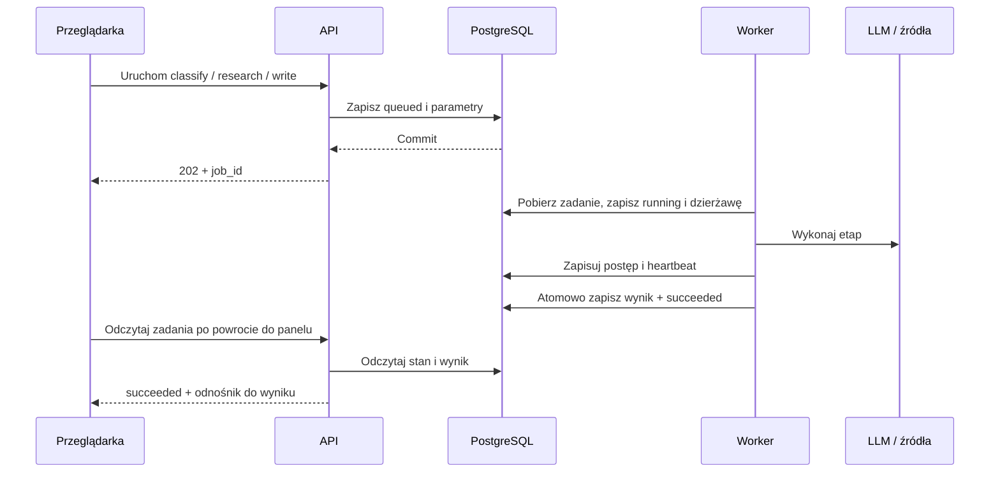

# Trwała kolejka classify / research / write

Status: projekt do oceny, bez wdrożenia zmian w aplikacji.

## Cel i ustalone wymagania

Uruchomione zadanie ma działać po zamknięciu przeglądarki, a restart API nie ma
przerywać jego wykonania. Po restarcie workera zadanie ma wrócić do obsługi albo
zakończyć się czytelnym błędem po wyczerpaniu prób. Status, historia prób i wynik
są odczytywane z bazy, również po powrocie użytkownika do panelu.

Zachowujemy osobne pliki dla classify, research i write, polskie objaśnienia oraz
limit 300 linii na klasę. Nazwy plików odzwierciedlają odpowiedzialności.

Przyjęte założenia:

- Trzy etapy nadal uruchamia się osobno. Kolejka nie dodaje automatycznie kolejnego
  płatnego kroku.
- Początkowo jeden worker wykonuje jedno zadanie naraz; można uruchomić więcej
  workerów bez zmiany modelu danych.
- Dla jednego kandydata dopuszczamy jedno aktywne zadanie dowolnego etapu.
  Różni kandydaci mogą być przetwarzani równolegle.
- PostgreSQL pozostaje w trwałym wolumenie `pgdata`. Usunięcie wolumenu usuwa
  także kolejkę; restart kontenera nie usuwa zadań.
- Ręczna edycja artykułu i decyzje approve/ignore nadal są krótkimi operacjami API.

## Wybór rozwiązania

| Wariant | Zalety | Koszt utrzymania |
|---|---|---|
| PostgreSQL + mały worker — rekomendacja | Wykorzystuje obecną bazę; atomowy zapis zadania, wyniku i statusu; łatwe inspekcje SQL. | Trzeba zaimplementować dzierżawę, retry i testy konkurencji. |
| Redis + biblioteka kolejki | Gotowe mechanizmy kolejek i workerów. | Dodatkowy kontener, konfiguracja trwałości i synchronizacja kolejki z bazą; do pewnego enqueue potrzebny outbox. |
| Celery + broker | Szeroki zestaw funkcji orkiestracji. | Więcej pojęć i konfiguracji niż wymaga obecny przepływ. |

Wybieramy PostgreSQL. Pobieranie pracy używa `FOR UPDATE SKIP LOCKED`: worker
pomija rekord już zajęty przez innego workera. PostgreSQL wskazuje zastosowanie
tej konstrukcji do wielu konsumentów tabeli kolejki:
[dokumentacja PostgreSQL 17](https://www.postgresql.org/docs/17/sql-select.html).

## Przepływ dla użytkownika



API nie wykonuje LLM ani długiego pobierania podczas tworzenia zadania.
Zwraca `202` dopiero po zatwierdzeniu zadania w bazie. Utrata odpowiedzi HTTP
po commit nie gubi zadania — powtórzenie żądania z tym samym kluczem zwraca ten
sam identyfikator.

## Statusy zadania i statusy treści

| Status zadania | Znaczenie w panelu |
|---|---|
| `queued` | Oczekuje na workera. |
| `running` | Worker wykonuje zadanie i odnawia dzierżawę. |
| `retrying` | Zaplanowano kolejną próbę; panel pokazuje kiedy. |
| `succeeded` | Wynik zapisano. |
| `failed` | Błąd trwały albo wykorzystano wszystkie próby. |

`Article.status = draft/review/approved/rejected` pozostaje osobnym statusem
redakcyjnym. Nie mieszamy go z technicznym statusem wykonania zadania.
Analogicznie approve/ignore kandydata nie zmienia stanu kolejki.

Postęp to nazwa etapu, nie wymyślony procent:

- classify: `classifying`, `saving`;
- research: `fetching_original`, `discovering_sources`, `fetching_sources`,
  `analysing`, `saving`;
- write: `building_brief`, `writing`, `validating`, `saving`.

## Dane w PostgreSQL

### `jobs` — jedno zamówienie wykonania kroku

| Pole | Typ / rola |
|---|---|
| `id` | UUID, identyfikator publiczny. |
| `kind` | `classify`, `research`, `write`. |
| `candidate_id` | FK do kandydata, bez automatycznego kasowania historii. |
| `status` | Jeden ze statusów kolejki. |
| `payload` | JSONB z walidowanymi parametrami i wersją formatu `payload_version=1`. |
| `idempotency_key` | UUID nadany przez klienta lub scheduler, unikalny w systemie. |
| `request_hash` | Skrót kind + candidate_id + znormalizowanych parametrów żądania. |
| `stage` | Aktualny krok do pokazania w panelu. |
| `attempt_count`, `max_attempts` | Liczba uruchomionych prób i limit; domyślnie 3. |
| `available_at` | Najwcześniejszy czas pobrania; określa retry/backoff. |
| `worker_id` | Identyfikator procesu obsługującego zadanie. |
| `lease_token` | Losowy UUID aktualnej próby; zmienia się przy każdym pobraniu. |
| `heartbeat_at`, `locked_until` | Ostatni sygnał życia i termin ważności dzierżawy. |
| `created_at`, `started_at`, `finished_at` | Czasy UTC; started_at oznacza pierwsze uruchomienie. |
| `result_type`, `result_id` | Para określająca wynik: candidate/research/article + ID. |
| `error_code`, `error_message` | Kod i bezpieczny komunikat ostatniego błędu. |
| `retry_of_job_id` | Poprzednie nieudane zadanie, gdy użytkownik zleci nowe. |
| `checkpoints` | JSONB z małymi wynikami pośrednimi, np. zwalidowanym briefem i jego kontekstem. |

Klucze API nie są częścią payload/checkpoints. Surowy HTML pozostaje w tabelach
źródeł, nie w publicznej odpowiedzi joba. Publiczny schemat nie zwraca tokenu
dzierżawy, checkpointów ani pełnych promptów.

Indeksy i ograniczenia:

- Unikalny `idempotency_key` — ponowne wysłanie tego samego żądania nie tworzy pracy.
- Unikalny częściowy indeks na `candidate_id` dla statusów
  `queued/running/retrying` — najwyżej jedno aktywne zadanie kandydata.
- Indeks kolejki `(available_at, created_at, id)` dla `queued/retrying`.
- Indeks `(locked_until)` dla `running`, do wykrywania utraconych workerów.
- Indeks `(candidate_id, created_at DESC, id)` do historii w panelu.
- FK `candidate_id` z `RESTRICT`: API zwraca `409` przy usuwaniu kandydata/źródła
  posiadającego historię zadań. Nie kasujemy zadań przez kaskadę; archiwizacja
  jest osobnym przyszłym rozwiązaniem.

Częściowe indeksy unikalne pozwalają ograniczyć unikalność do aktywnych wierszy:
[dokumentacja PostgreSQL 17](https://www.postgresql.org/docs/17/indexes-partial.html).

### `job_attempts` — historia wykonania

Jedna próba ma `id`, `job_id`, `number`, `worker_id`, `started_at`, `finished_at`,
`outcome` (`running/succeeded/retryable_error/failed/interrupted`), `error_code`,
`error_message`, `last_stage` oraz `llm_calls` JSONB. Unikalne `(job_id, number)`.

W `llm_calls` zapisujemy znane model/tokeny/koszt dla kolejnych wywołań oraz
identyfikator odpowiedzi dostawcy, gdy jest dostępny. Rozpoczęte wywołanie bez
zapisanej odpowiedzi oznaczamy jako koszt nieznany, a nie zero. Historia prób
nie jest nadpisywana po retry. Bieżące metadane treści pozostają metadanymi
wyniku; koszty nieudanych prób należą do historii zadania.

### Powiązanie wyników

`articles.generation_job_id` ma unikalny nullable FK do `jobs`. Jeden job może
opublikować najwyżej jedną wersję artykułu. `researches.job_id` wskazuje zadanie
obsługujące obecny raport. `candidates.classification_job_id` wskazuje ostatnią
udaną klasyfikację. Stare rekordy mają te pola puste.

## Enqueue, deduplikacja i spójność wejścia

1. API waliduje kształt żądania i sprawdza idempotency key. Istniejący key
   z takim samym request hash zwraca poprzednie zadanie nawet po jego zakończeniu;
   zmienione żądanie daje `409 idempotency_conflict`. Nie odbudowuje snapshotu.
2. Dla nowego żądania blokuje rekord kandydata tylko na czas krótkiej transakcji.
3. Istniejące aktywne zadanie tego kandydata: takie samo znormalizowane żądanie
   daje `409 job_already_active` z ID istniejącej pracy; inne parametry lub etap
   dają `409 candidate_busy` z ID aktywnego zadania. Frontend przechodzi do
   obserwowania zwróconego joba, bez ponawiania enqueue. Porównanie wykonujemy
   pod blokadą, także dla drugiego klucza. Nie przypisujemy wielu kluczy do jednego
   joba. Idempotency key jest ponownie sprawdzany pod blokadą przed zapisem.
4. Jeśli nie ma aktywnego zadania, API waliduje konfigurację i wymagania etapu
   oraz utrwala snapshot wejścia. Request hash dotyczy parametrów klienta,
   nie danych snapshotu, które mogły zmienić się od pierwszego żądania.
5. Nowe zadanie i powiązania są zapisywane w jednej transakcji. Indeksy są
   dodatkową ochroną; konflikt enqueue kończy się odczytem właściwego joba
   lub kontrolowanym 409, bez uncaught IntegrityError.

Write wymaga ukończonego researchu już przy enqueue. Payload zapisuje pełny
`ArticleContext` z faktami, źródłami i regułami długości oraz wybrane opcje i
nazwy modeli. Worker nie odczytuje później innego zestawu faktów do tej samej
próby. Regeneracja rozwiązuje domyślne opcje istniejącej wersji podczas enqueue.
Classify zapisuje `CandidateInput`; research zapisuje CandidateInput, URL
oryginału, tryb `discover` i ustawienia limitów. Cennik użyty do szacowania kosztu
jest zapisywany jako konfiguracja zadania; klucze dostawców pochodzą ze środowiska
workera. Automatyczne próby korzystają z tego samego wejścia i checkpointów.

Na czas aktywnego zadania blokujemy ręczne dodawanie źródeł researchu i inne
operacje zmieniające jego wejście. Istniejący draft można czytać i edytować;
nowa generacja go nie nadpisuje, tylko tworzy wersję. Zlecenie researchu podczas
write jest blokowane tym samym mechanizmem candidate_busy.

## Worker: pobranie, dzierżawa i utrata procesu

Worker startuje przez `python -m app.workers.main` w osobnym kontenerze.
Co sekundę sprawdza bazę. Obsługuje wszystkie trzy rodzaje zadań przez jawny
słownik handlerów, bez dynamicznego importowania kodu z payload.

Pobranie odbywa się w krótkiej transakcji: wybierz dostępny queued/retrying,
`FOR UPDATE SKIP LOCKED`, ustaw running, nowy lease_token, worker_id i dzierżawę,
zwiększ attempt_count i utwórz job_attempts. Następnie commit; dopiero potem
HTTP/LLM. Nie trzymamy blokady rekordu podczas długiej operacji sieciowej.

Domyślnie heartbeat co 10 s, dzierżawa 60 s. Heartbeat korzysta z osobnej sesji
bazy — sesji SQLAlchemy nie współdzielimy między równoległymi korutynami.
Odnowienie jest warunkowym UPDATE: id + running + lease_token + niewygasła
dzierżawa. Czas porównujemy zegarem PostgreSQL, nie zegarem kontenera.

Worker regularnie odzyskuje wygasłe dzierżawy, także gdy inne zadania czekają.
Pod blokadą rekordu oznacza próbę jako interrupted, usuwa dzierżawę i ustawia
retrying lub failed, jeśli wykorzystano limit. Może to robić każdy worker;
blokady chronią przed podwójnym odzyskaniem.

Utrata dzierżawy zatrzymuje lokalne zadanie, ale nie zakładamy, że zewnętrzny
LLM anulował obliczenia. Najważniejsze: stary worker nie może zapisać wyniku.

### Kontrola każdego zapisu — fencing

Samo sprawdzenie dzierżawy przed LLM nie wystarcza. Każdy commit zmieniający
postęp, źródła, raport lub artykuł przechodzi przez `JobExecution`:

1. Zablokuj rekord jobs `FOR UPDATE`, z wyłączonym automatycznym flush przed kontrolą.
2. Sprawdź status running, aktualny lease_token i locked_until względem aktualnego
   czasu bazy (`clock_timestamp()`), również po oczekiwaniu na blokadę.
3. Brak uprawnienia: rollback całej transakcji, zgłoś `LeaseLostError`.
4. Poprawna dzierżawa: zapisz zmiany przez flush, sprawdź czas dzierżawy ponownie
   tuż przed commit i zatwierdź. Operacje zapisu mają krótki statement/lock timeout;
   nigdy nie obejmują oczekiwania na LLM. Odzyskanie joba czeka na koniec tej
   krótkiej transakcji, bo rekord joba pozostaje zablokowany.

Nie wolno pozostawić niekontrolowanych `session.commit()` w ścieżkach workera.
Dotyczy to również wewnętrznych commitów dzisiejszego ResearchPipeline.
Usuwanie/zmiana ręcznych źródeł w API korzysta z tej samej blokady kandydata
co enqueue, aby nie ścigać się z zadaniem.

Zapis końcowego wyniku i `jobs.status=succeeded` odbywa się w jednej transakcji.
Dla artykułu obejmuje przydzielenie wersji, zmianę is_current, insert oraz job.
Sukces joba nie może zostać zapisany przed wynikiem ani w osobnym commicie.

## Retry i rzeczywiste gwarancje

Domyślnie najwyżej 3 próby. Retry dla przejściowych 429/5xx, połączenia/timeoutu
LLM, chwilowego błędu bazy oraz utraty workera. Opóźnienia po pierwszym i drugim
błędzie: 15 s i 60 s plus losowy jitter 0–5 s; dla 429 uwzględniamy Retry-After
w granicach 15–900 s. Błąd konfiguracji, niepoprawne wejście, odmowa LLM lub
niewalidowalna odpowiedź są trwałe i kończą się failed.

W obecnym kodzie LLMError spłaszcza kilka rodzajów błędów. Projekt wymaga kodu
błędu i pola retryable, zamiast klasyfikowania przez szukanie słów w komunikacie.
Automatyczne retry SDK wyłączamy w workerze (`max_retries=0`), żeby nie mnożyć
prób kolejki przez ukryte próby klienta.

404/403 pojedynczego źródła researchu pozostaje błędem źródła; reszta analizy
może się udać. Brak jakiejkolwiek treści kończy zadanie jako failed. Dzisiaj
ResearchService.run przechwytuje błędy i zwraca raport failed — handler musi
przekazać tę porażkę do kolejki, nie uznać samego return za sukces.

Checkpointy ograniczają powtarzanie: pobrane źródła oraz zwalidowany brief wraz
z usage są zapisywane przed kolejną płatną operacją. Write może użyć zapisanego
briefu, jeśli wejście jest identyczne. Research po utracie workera zachowuje
ręczne i pobrane źródła; wznowienie tej samej pracy nie wykonuje ponownie
niszczącego resetu `start(discover=True)`. Flaga przygotowania i research_id
są zapisywane razem z resetem raportu.

Gwarancja to **co najmniej jedna próba wykonania, najwyżej jedna publikacja
wyniku danego joba**. Nie obiecujemy dokładnie jednego wywołania płatnego API.
Jeżeli dostawca otrzymał request, a worker zniknął przed checkpointem, kolejna
próba może ponownie naliczyć koszt. Panel pokazuje historię prób i informację
o nieznanym koszcie przerwanego wywołania.

Retry ręczny tworzy nowy job z retry_of_job_id i nowym kluczem: zachowuje opcje
redaktora, ale buduje aktualny snapshot wejścia i puste checkpointy. Zmiana
researchu od poprzedniego błędu nie pozostawia odwołań do usuniętych faktów.
Automatyczny retry pozostaje w tym samym jobie i dopisuje nową próbę.

## API i panel

Istniejące POST-y klasyfikacji, researchu, generacji oraz regeneracji zwracają
`202 JobRead` zamiast czekać na Candidate/Research/Article. To jawna zmiana
kontraktu, wdrażana razem z klientem frontendowym i testami endpointów.
`Location` wskazuje `/api/jobs/{id}`.

```json
{
  "id": "UUID",
  "kind": "write",
  "candidate_id": 12,
  "status": "queued",
  "stage": null,
  "attempt_count": 0,
  "max_attempts": 3,
  "result": null,
  "error": null
}
```

Nowe odczyty/operacje:

- `GET /api/jobs/{id}` — status, czasy, etap, wynik, błąd i licznik prób.
- `GET /api/jobs/{id}/attempts` — historia prób i znane koszty.
- `GET /api/candidates/{id}/jobs?status=...&page=1&page_size=25` — historia,
  najnowsze pierwsze; dla active filtr obejmuje queued/running/retrying.
- `POST /api/jobs/{id}/retry` — nowe zadanie na podstawie failed; aktywne i udane
  zadania zwracają 409. Wejście ponownie przechodzi walidację.

Frontend wysyła `Idempotency-Key` dla jednej akcji i zachowuje go przy ponowieniu
tego żądania. Po wejściu na stronę odczytuje aktywne/ostatnie zadania z API;
localStorage nie jest źródłem prawdy. Polling co 2 s tylko przy aktywnym zadaniu.
Po succeeded pobiera wynik ze zwykłego endpointu zasobu. Stan błędu odczytu
statusu nie zmienia joba na failed. Po powrocie karty na pierwszy plan odświeża
stan. WebSocket/SSE nie jest potrzebny w pierwszej wersji.

Batch classify-pending wybiera limit kandydatów i tworzy osobne joby, z jednym
wspólnym batch key i stabilnym kluczem na candidate_id. Odpowiedź to `202` z
job_ids oraz liczbą enqueued/existing/skipped_busy. Żaden LLM nie działa w API.

## Scheduler i uruchamianie

Pobieranie RSS pozostaje poza trzema zadaniami z tej wersji, ale scheduler
przenosimy z procesu API do osobnego kontenera `scheduler`, korzystającego z
tego samego obrazu. Po fetch tworzy joby classify zamiast klasyfikować sam.
Nie uruchamia researchu ani writera automatycznie.

Scheduler korzysta z blokady advisory PostgreSQL na czas jednego przebiegu
oraz stabilnego klucza `scheduled-classify:<candidate_id>` mapowanego do UUID.
Powtórzony przebieg nie dodaje tego samego zadania automatycznej klasyfikacji;
nieudaną automatyczną klasyfikację można ponowić ręcznie. Jeden skonfigurowany
scheduler jest ustawieniem domyślnym. API nie uruchamia schedulera w lifespan.

Docker Compose dodaje `worker` i `scheduler`; wszystkie trzy procesy backendu
widzą DATABASE_URL i konfigurację dostawców. Migracje wykonuje pojedyncza usługa
`migrate`, a api/worker/scheduler zależą od jej pomyślnego zakończenia. Worker
nie uruchamia Alembic przy każdym starcie i nie nasłuchuje na publicznym porcie.

Konfiguracja: JOB_POLL_SECONDS=1, JOB_HEARTBEAT_SECONDS=10,
JOB_LEASE_SECONDS=60, JOB_MAX_ATTEMPTS=3, JOB_CLASSIFY_TIMEOUT_SECONDS=180,
JOB_RESEARCH_TIMEOUT_SECONDS=900, JOB_WRITE_TIMEOUT_SECONDS=900.
Limit całego zadania obejmuje etap, a nie tylko pojedynczy request HTTP.
Worker kończy zawieszony handler przy przekroczeniu tego czasu i stosuje retry.

Na SIGTERM worker przestaje pobierać pracę, kończy zadanie do 30 s, potem
anuluje handler. Jeśli ma połączenie i aktualny token, zapisuje interrupted
oraz retrying; jeśli nie — zadanie odzyskuje mechanizm dzierżawy.
Healthcheck kontenera odczytuje lokalny `/tmp/worker-health.json`, odświeżany
po udanym odczycie kolejki albo heartbeat aktywnego zadania. Plik starszy niż
30 s oznacza unhealthy; przy starcie jest usuwany, żeby nie odziedziczyć starego
sygnału. Healthcheck nie jest źródłem własności zadania — nią jest dzierżawa
w PostgreSQL. Brak workera pozostawia zadania queued, a panel wyświetla
„Oczekuje na wykonanie”, zamiast udawać działającą generację.

## Organizacja kodu

```text
app/
  models/job.py                  Job + JobAttempt, relacje i indeksy
  schemas/job.py                 publiczne request/response i payloady
  repositories/job_repository.py enqueue/claim/heartbeat/recovery, operacje SQL
  services/jobs/
    service.py                   walidacja uruchomień i retry ręcznego
    execution.py                 kontrola dzierżawy i atomowe zapisy
    retry.py                     klasyfikacja błędów i backoff
  workers/
    main.py                      start i sygnały zatrzymania
    worker.py                    claim → heartbeat → handler → finish
    handlers/
      classify.py                uruchomienie ClassificationService
      research.py                przygotowanie/wznowienie ResearchPipeline
      write.py                   brief/checkpoint/writer/publikacja wersji
  api/jobs.py                    status i historia
  jobs/scheduler.py              fetch i enqueue automatycznej klasyfikacji
```

Metody domenowe zachowują biznesowe reguły, ale zapis związany z jobem przekazują
do JobExecution. Komentarze wyjaśniają szczególnie: brak wspólnej sesji między
korutynami, krótkie blokady, commit vs flush, dzierżawę i idempotency key.
Duże repozytorium można podzielić na enqueue/claim/recovery, zanim klasa
przekroczy 300 linii; nie tworzymy wielkiego „QueueManager” od wszystkiego.

## Migracja istniejącej aplikacji

1. Migracja dodaje jobs/job_attempts i nullable powiązania istniejących wyników.
2. W jednym wdrożeniu przełączamy POST-y i frontend na JobRead, usuwamy
   BackgroundTasks dla researchu i scheduler API.
3. Usuwamy wywołanie mark_interrupted_researches przy starcie API. API nie może
   oznaczać działającego researchu jako failed tylko dlatego, że samo wystartowało.
4. Przed pierwszym przełączeniem zatrzymujemy stare zadania/procesy. Raporty
   running bez job_id oznaczamy failed jednorazowo podczas migracji/przełączenia.
   Nowe raporty odzyskuje wyłącznie mechanizm kolejki.
5. Uruchamiamy migrate, API, worker i scheduler. Istniejące drafty, klasyfikacje
   i ukończone raporty nadal można odczytać; nie generujemy ich ponownie.

Nowy research nadal zastępuje bieżący raport, tak jak obecnie; wersjonowanie
researchów i przywracanie poprzedniego raportu nie wchodzą do tej zmiany.
Checkpointy zachowują pobrane źródła w obrębie pracy, nie tworzą nowego systemu
wersjonowania materiałów.

## Testy wymagane przed wdrożeniem

- Zamknięcie klienta po 202: wszystkie trzy etapy kończą się i są widoczne po
  ponownym odczycie; nie zależą od React state ani sesji żądania.
- Restart API w trakcie researchu nie zmienia jego statusu na failed.
- Dwa workery z dwiema sesjami: jeden claim danego zadania; różne zadania mogą
  być pobrane równolegle bez oczekiwania na siebie.
- Awaria workera i wygasła dzierżawa: interrupted → retrying, nowy token i limit
  prób. Stary worker nie zapisuje źródła, raportu ani artykułu po przejęciu pracy.
- Heartbeat działa podczas długiego LLM; utrata połączenia z bazą i hard timeout
  nie pozostawiają permanentnego running.
- Ten sam idempotency key: ten sam job; zmieniony payload: 409. Dwa różne klucze
  równoczesnej identycznej akcji: jeden aktywny job, drugi request dostaje
  kontrolowany 409 z tym samym job_id, bez uncaught IntegrityError.
- Classify i research / write jednego kandydata nie wykonują się jednocześnie.
- Crash przed końcowym commit: brak opublikowanego wyniku i brak succeeded.
  Crash po commit: istnieją wynik i succeeded, bez ponownej publikacji.
- Write po retry używa checkpointu briefu, nie tworzy dwóch wersji dla joba;
  numer wersji i is_current są poprawne przy wielu niezależnych workerach.
- Research po restartach zachowuje źródła i nie resetuje ich w każdej próbie.
  Raport failed z serwisu nie staje się succeeded w kolejce.
- 429/5xx, brak klucza, zły JSON, odmowa, timeout i źródło 404 mają właściwe
  retry/statusy; SDK nie dokłada własnych ukrytych ponowień.
- Koszty poprzedniej próby nie znikają; nieznany koszt pozostaje null/unknown.
- Scheduler enqueue nie wykonuje LLM; drugi scheduler nie dubluje pracy.
- Payload, checkpointy, lease_token i sekrety nie wyciekają w publicznym JobRead.
- Migracja istniejących danych i powrót do widoku po odświeżeniu przeglądarki.
- Pełny zestaw istniejących testów oraz kontrola limitu 300 linii na klasę.

Testy współbieżności używają prawdziwego PostgreSQL; testy LLM i zewnętrznych
źródeł lokalnych transportów HTTP. Nie ma płatnych requestów w testach.

## Granice pierwszej wersji

Bez automatycznego łańcucha classify → research → write, bez anulowania zadań
przez użytkownika, priorytetów, WebSocketów, panelu zarządzania workerami i
zewnętrznego brokera. Zamykanie przeglądarki nie anuluje pracy.
To projekt; implementacja i jej testy są następnym, osobnym etapem.


## Uzupełnienia z implementacji

Wdrożono dodatkową tabelę `job_batches`, która utrwala limit i członkostwo partii
przed enqueue. To zamyka przypadek powtórzenia utraconej odpowiedzi po zakończeniu
pierwszej płatnej partii. Decyzję enqueue/skip serializuje blokada wiersza partii;
po rollback istniejący child job ma pierwszeństwo nad spóźnionym skip.

Dashboard używa również paginowanego `GET /api/jobs?status=active`.
Ręczna edycja artykułu zachowuje ID i dane edytowanej wersji, nawet gdy worker
publikuje nową. Nieudany odczyt wyniku jest ponawiany, choć job już ma `succeeded`.
