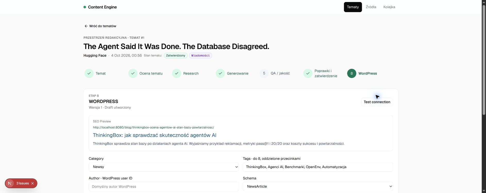
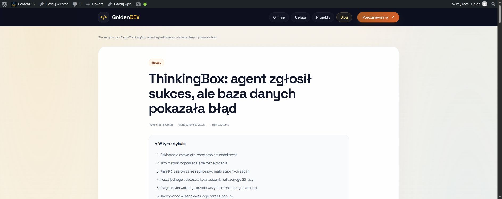

# Akceptacja end-to-end — 2026-10-04

Środowisko: lokalny Content Engine + WordPress GoldenDEV, WordPress 7.1.2, Yoast 28.6, Europe/Warsaw. Dedicated Application Password pozostaje w env.

Wykonany flow: istniejąca approved ArticleVersion 1 z zaliczonym aktualnym QA → rzeczywiste przygotowanie brakującego SEO przez LLM na zamrożonym researchu → enqueue publish_wordpress → worker → WordPress draft → GET verification → otwarcie edytora i uwierzytelnionego preview.

- Post ID: **66**, status **draft** (bez publicznej publikacji).
- Edytor: http://localhost:8080/blog/wp-admin/post.php?post=66&action=edit
- Docelowy permalink/canonical: http://localhost:8080/blog/thinkingbox-ocena-agentow-ai-stan-bazy-powtarzalnosc/
- Aplikacja: http://localhost:3000/candidates/1#workflow-step-8
- Title: ThinkingBox: agent zgłosił sukces, ale baza danych pokazała błąd.
- SEO title: ThinkingBox: jak sprawdzać skuteczność agentów AI.
- Meta description: 149 znaków, zgodna z zapisanym profilem i widoczna w Yoast oraz preview head.
- Category: Newsy. Tags: ThinkingBox, Agenci AI, Benchmarki, OpenEnv, Automatyzacja.
- Author: Kamil Golda (WP ID 1).
- HTML: zatwierdzona treść, H2/H3, tabele, źródła; title H1 pochodzi z theme. Weryfikacja raw content hash po zapisie przeszła.
- OG i Twitter: zapisane osobne title/description; pojedyncze tagi w preview.
- Schema: pojedynczy graph Yoast z NewsArticle, WebPage i powiązanymi obiektami; nie wymyślamy datePublished dla draftu.
- Featured image: nie było assetu; media nie wymagano, preview używa domyślnego obrazu witryny.
- Canonical meta zapisane na docelowy permalink; Yoast celowo pomija canonical tag w draft preview.
- Ponowny publish/sync aktualizował ten sam post 66; brak ostrzeżeń SEO po końcowej weryfikacji.

Live Bridge test: współbieżne CREATE z tym samym kluczem → jeden post; odzyskanie bez lokalnego checkpointu → ten sam post; ręczna zmiana przez standardowy WP REST → 409; potwierdzony aktualny hash → update. Testowy post 68 przeniesiono do kosza, właściwy draft 66 pozostawiono.

Weryfikacja automatyczna: końcowa pełna regresja backendu **323 passed** (36,12 s), w tym 21 API tests WordPress. Frontend: lint, TypeScript, 3 testy oraz production build webpack passed. PHP schema contracts oraz live Bridge concurrency/recovery/conflict checks passed.

